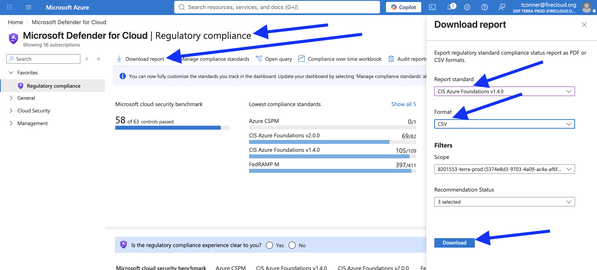

# Azure CIS Report Downloader

This is an automated script that downloads CIS reports from Azure.

It replaces the following manual process:

1. Go to Beehive](https://beehive.dsp-devops-prod.broadinstitute.org/) and "break
   glass", i.e. obtain Prod Admin privileges.
2. Go to the
   [Microsoft Defender Regulatory Compliance](https://portal.azure.com/#view/Microsoft_Azure_Security/SecurityMenuBlade/~/22)
   page, authenticating as the `@firecloud.org` account that gains admin privileges from
   breaking glass.
3. Download the CSV report for the *CIS Azure Foundations Benchmark v1.4.0* and
   *v2.0.0*.

